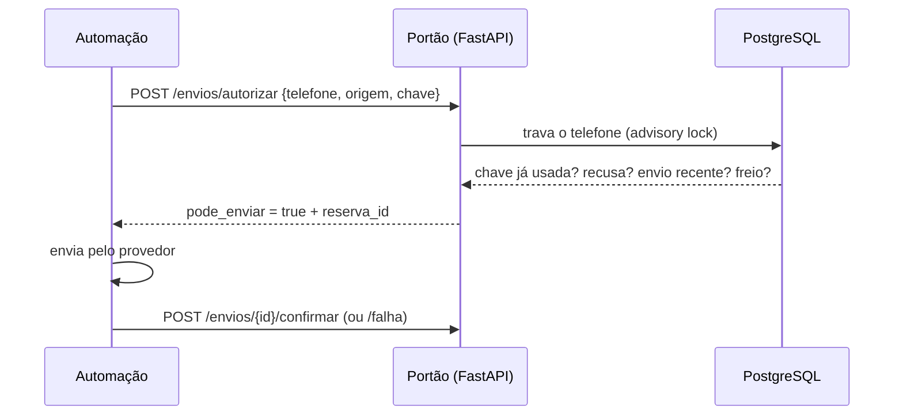

# Portão de envio

[](https://github.com/geanprofcd/portao-de-envio/actions/workflows/testes.yml)

**O problema:** quando várias automações podem mandar mensagem para o mesmo cliente (um disparo, um follow-up, uma resposta de IA), cedo ou tarde duas delas mandam ao mesmo tempo, ou uma repete a chamada depois de um erro de rede. O cliente recebe a mesma mensagem duas vezes, ou recebe mensagem depois de pedir para parar.

**A solução:** um serviço pequeno que toda automação consulta antes de enviar. Ele responde "pode" ou "não pode, por este motivo", e a regra vale para todas, porque mora num lugar só: o banco.

Este projeto nasceu de um problema real num sistema meu em produção. O código aqui foi escrito do zero, em versão reduzida, para mostrar a ideia.

## Como funciona



Regras, na ordem:
1. **Telefone válido**, normalizado para 55 + DDD + número (aceita máscara, +55, zero de operadora e celular antigo sem o nono dígito).
2. **Idempotência:** a mesma `chave` sempre devolve a mesma reserva. Se a automação repetir a chamada, não nasce um segundo envio. A mesma chave para outro telefone é conflito (409).
3. **Recusa:** quem pediu para parar não recebe nada, de nenhuma origem.
4. **Janela:** um envio por telefone dentro da janela (padrão: 24 horas). Uma falha libera o telefone para nova tentativa.
5. **Freio:** se muitos envios falharam em pouco tempo (padrão: 10 em 10 minutos), o portão segura tudo até a situação normalizar.

Tudo roda numa transação com `pg_advisory_xact_lock` por telefone. Duas automações que chegam no mesmo milissegundo esperam uma pela outra, e só uma passa.

## Testes

```bash
pip install -r requirements-dev.txt
DATABASE_URL=postgresql://... python -m pytest -v
```

Os testes rodam contra um PostgreSQL de verdade (no GitHub Actions, um serviço `postgres:16`). Destaques:
- 20 automações pedem o mesmo telefone ao mesmo tempo, cada uma com sua chave: exatamente uma passa e só uma linha é gravada.
- A mesma chamada repetida 10 vezes ao mesmo tempo gera uma reserva só.
- Recusa bloqueia disparo, follow-up e IA.
- O freio liga depois do limite de falhas.
- Confirmar duas vezes, ou marcar falha depois de enviado, não muda nada.

## Rodar

```bash
docker compose up --build
```

```bash
curl -X POST localhost:8000/envios/autorizar -H "X-Chave-Api: troque-esta-chave" -H "Content-Type: application/json" -d '{"telefone": "(11) 90000-0001", "origem": "disparo", "chave": "campanha-1-contato-1"}'
```

| Rota | O que faz |
|---|---|
| `POST /envios/autorizar` | Pede autorização para enviar |
| `POST /envios/{id}/confirmar` | Confirma que a mensagem saiu |
| `POST /envios/{id}/falha` | Registra falha e libera nova tentativa |
| `POST /contatos/recusas` | Registra que o contato pediu para parar |
| `GET /saude` | Verificação simples |

Configuração por ambiente: `DATABASE_URL`, `PORTAO_CHAVE` (obrigatória), `PORTAO_JANELA_HORAS`, `PORTAO_FREIO_FALHAS`, `PORTAO_FREIO_MINUTOS`.

## Stack

Python 3.12, FastAPI, PostgreSQL 16, psycopg 3, pytest, Docker Compose, GitHub Actions.

## Autor

Gean Bonni, desenvolvedor Python. [LinkedIn](https://www.linkedin.com/in/geanbonni) · [GitHub](https://github.com/geanprofcd)
